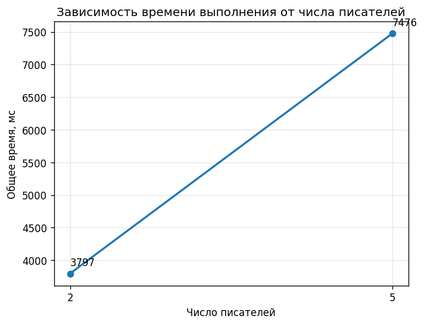
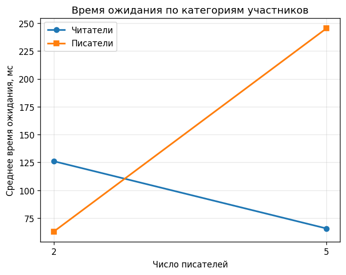
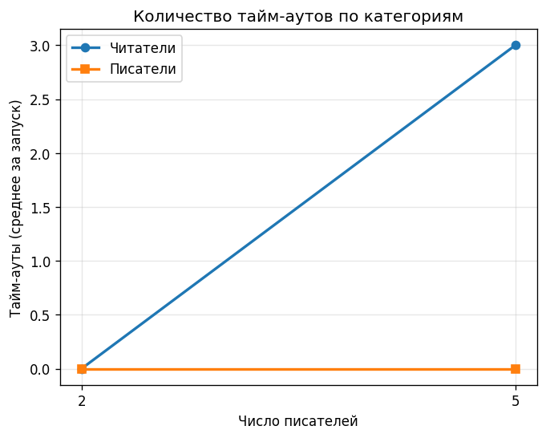

# Lab 04 — Синхронизация (Вариант 10)

Модель «Писатели–читатели», приоритет писателей.
Механизмы: Mutex, Semaphore.

## Общие ресурсы
- `g_resource` (Semaphore, init=1) — доступ к разделяемым данным.
- `g_readTry`  (Semaphore, init=1) — шлагбаум writers-preference.
- `g_rmutex`   (Mutex) — защита `g_readCount`.
- `g_wmutex`   (Mutex) — защита `g_writeCount` и координация `g_readTry`.

## Алгоритм
- Первый ожидающий писатель захватывает `g_readTry` → новые читатели блокируются.
- Уже читающие читатели дочитывают; последний освобождает `g_resource`.
- Писатели выполняются по одному; шлагбаум возвращается, когда все писатели завершились.

## Индивидуальные параметры
STUDENT_ID = 123
SEED = 1000 + STUDENT_ID * 97
OPERATIONS = BASE_OPERATIONS + STUDENT_ID * 5

## Среда
Windows 10/11, MSVC 2019+ (Developer PowerShell for VS 2022), C++17.

## Сборка
    cl /nologo /std:c++17 /EHsc /O2 /W3 /DNOMINMAX /Fe:build\main.exe /Fo:build\ src\main.cpp

## Запуск
    .\build\main.exe --readers 3 --writers 2 --ops 20 --log events_3r2w.log
    .\build\main.exe --readers 3 --writers 5 --ops 20 --log events_3r5w.log
    .\build\main.exe --readers 3 --writers 5 --ops 20 --quiet

## Тесты
    .\tests\run_tests.ps1
    .\tests\check_invariants.ps1

*Рисунок 1 — Зависимость общего времени выполнения от числа писателей.*

*Рисунок 2 — Среднее время ожидания читателей и писателей.*

*Рисунок 3 — Среднее число тайм-аутов по категориям участников.*